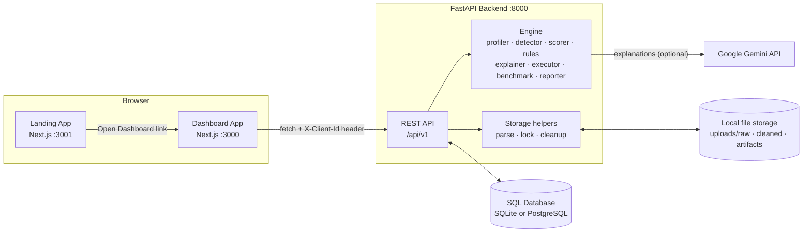
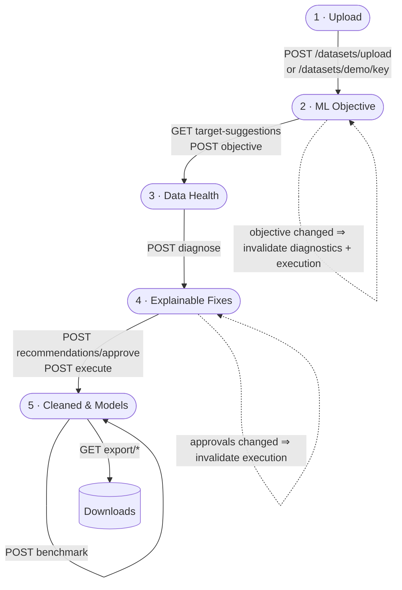

# Nebulus — Architecture & System Walkthrough

> **Nebulus** is an explainable pre-ML data readiness platform. A user uploads a tabular dataset (CSV / Excel), picks what they want to predict, and Nebulus profiles the data, scores it 0–100, recommends fixes with plain-English explanations, applies only the fixes the user approves, re-scores the result, benchmarks ML models honestly, and exports a cleaned dataset, a reproducible Python script, a PDF audit report and a JSON manifest.

## 🎥 Website Demo

Watch the **Nebulus — AI Data Readiness Platform** website demo:

[▶️ Watch Demo Video](Demo/Demo.mp4)

---

## Table of Contents

1. [High-Level Overview](#1-high-level-overview)
2. [Repository Layout](#2-repository-layout)
3. [Technology Stack](#3-technology-stack)
4. [End-to-End User Flow](#4-end-to-end-user-flow)
5. [Backend Architecture](#5-backend-architecture)
   - 5.1 [Application Bootstrap](#51-application-bootstrap)
   - 5.2 [Configuration](#52-configuration)
   - 5.3 [Database Layer](#53-database-layer)
   - 5.4 [Data Model (ER Diagram)](#54-data-model)
   - 5.5 [Ownership, Locking & Invalidation](#55-ownership-locking--invalidation)
   - 5.6 [File Storage & Ingestion](#56-file-storage--ingestion)
   - 5.7 [REST API Reference](#57-rest-api-reference)
6. [The Engine (Core Intelligence)](#6-the-engine-core-intelligence)
   - 6.1 [Profiler](#61-profiler--profilerpy)
   - 6.2 [Detector](#62-detector--detectorpy)
   - 6.3 [Scorer](#63-scorer--scorerpy)
   - 6.4 [Rules Engine](#64-rules-engine--rulespy)
   - 6.5 [Explainer (Gemini + Fallback)](#65-explainer--explainerpy)
   - 6.6 [Transforms](#66-transforms--transformspy)
   - 6.7 [Executor](#67-executor--executorpy)
   - 6.8 [Benchmark](#68-benchmark--benchmarkpy)
   - 6.9 [Reporter](#69-reporter--reporterpy)
7. [Frontend Architecture](#7-frontend-architecture)
   - 7.1 [Monorepo](#71-monorepo)
   - 7.2 [Dashboard App](#72-dashboard-app-port-3000)
   - 7.3 [Landing App](#73-landing-app-port-3001)
8. [Request Lifecycles (Sequence Diagrams)](#8-request-lifecycles)
9. [State Machine & Invalidation Rules](#9-state-machine--invalidation-rules)
10. [Error Handling Strategy](#10-error-handling-strategy)
11. [Security Model](#11-security-model)
12. [Running the Project](#12-running-the-project)
13. [Testing & Verification](#13-testing--verification)
14. [Known Limitations & Future Work](#14-known-limitations--future-work)

---

## 1. High-Level Overview



**Design principles**

| Principle | How it is implemented |
|---|---|
| Deterministic decisions | Statistical rules choose every fix; the LLM only *explains* the chosen fix. |
| Human-in-the-loop | Every fix is a toggle; destructive fixes are off by default; nothing runs until “Execute”. |
| Honest evaluation | Scaling / imputation / SMOTE happen *inside* each CV fold; score can go down after cleaning. |
| Reproducibility | The exported Python script embeds the exact transform functions and reproduces the exported CSV. |
| Graceful degradation | Gemini down → statistical explanations; optional ML libs missing → skipped models. |
| Consistency | Changing upstream inputs (objective, approvals, diagnostics) invalidates downstream results. |

---

## 2. Repository Layout

```text
Major project/
├── ARCHITECTURE.md                 ← this document
├── README.md
├── backend/
│   ├── .env / .env.example         ← runtime configuration
│   ├── requirements.txt
│   ├── datareadiness.db            ← default SQLite DB (created on first run)
│   ├── uploads/
│   │   ├── raw/                    ← normalized uploaded datasets ({id}.csv)
│   │   ├── cleaned/                ← model-ready outputs ({id}_cleaned.csv)
│   │   └── artifacts/              ← pipeline scripts ({id}_pipeline.py)
│   └── app/
│       ├── main.py                 ← FastAPI app, CORS, lifespan
│       ├── core/
│       │   ├── config.py           ← pydantic-settings Settings
│       │   ├── database.py         ← engine, session, init_db + auto-migration
│       │   └── storage.py          ← parsing, normalization, locks, cleanup
│       ├── models/dataset.py       ← SQLAlchemy ORM models
│       ├── schemas/dataset.py      ← Pydantic request/response models
│       ├── api/
│       │   ├── deps.py             ← client id, ownership, snapshot, invalidation
│       │   └── v1/
│       │       ├── router.py
│       │       └── endpoints/
│       │           ├── health.py
│       │           ├── datasets.py        ← upload, demo, sample, session, delete
│       │           ├── objectives.py      ← target suggestions, objective
│       │           ├── diagnostics.py     ← profile + detect + score + recommend
│       │           ├── recommendations.py ← list, approve, regenerate explanations
│       │           ├── pipeline.py        ← execute approved fixes
│       │           ├── benchmarks.py      ← model leaderboard
│       │           └── exports.py         ← CSV, script, PDF, manifest
│       └── engine/
│           ├── profiler.py
│           ├── detector.py
│           ├── scorer.py
│           ├── rules.py
│           ├── explainer.py
│           ├── transforms.py
│           ├── executor.py
│           ├── benchmark.py
│           └── reporter.py
└── frontend/                       ← npm workspaces + Turborepo
    ├── package.json                ← "turbo dev" etc.
    └── apps/
        ├── dashboard/              ← the product UI (port 3000)
        │   └── src/
        │       ├── app/{layout,page}.tsx
        │       ├── services/api.ts
        │       └── components/
        │           ├── Header.tsx, Stepper.tsx
        │           ├── UploadStep.tsx, ObjectiveStep.tsx
        │           ├── HealthScoreGauge.tsx, ProfileTable.tsx (diagnostic view)
        │           ├── RecommendationChecklist.tsx
        │           ├── BeforeAfterDiff.tsx, ModelLeaderboard.tsx
        │           └── ExportHub.tsx
        └── landing/                ← marketing site (port 3001)
            └── src/
                ├── app/{layout,page,globals.css}
                ├── lib/motion.ts
                └── components/{Hero,Scanner,Features,Workflow,Exports,primitives}.tsx
```

---

## 3. Technology Stack

| Layer | Technology | Purpose |
|---|---|---|
| API | **FastAPI**, Uvicorn | REST endpoints, OpenAPI docs at `/docs` |
| Validation | **Pydantic v2**, pydantic-settings | Schemas, `.env` configuration |
| ORM / DB | **SQLAlchemy 2**, SQLite (default) / PostgreSQL (`psycopg2-binary`) | Persistence |
| Data | **pandas**, **NumPy**, SciPy | Parsing, profiling, transforms |
| ML | **scikit-learn**, **imbalanced-learn** (SMOTE), optional **XGBoost**, **LightGBM** | Benchmarking |
| Files | openpyxl (`.xlsx`), xlrd (`.xls`) | Excel ingestion |
| Reports | **ReportLab** | PDF audit report |
| AI | Google **Gemini** REST API (`requests`) | Natural-language explanations |
| Frontend | **Next.js 14** (App Router), **React 18**, TypeScript | Dashboard & landing |
| Icons | lucide-react | UI icons |
| Monorepo | npm workspaces + **Turborepo** | Run both apps together |

---

## 4. End-to-End User Flow

The dashboard is a five-step wizard. Each step is backed by one or more API calls.



| Step | What the user does | What the system does |
|---|---|---|
| **1. Ingestion** | Drags a CSV/XLSX/XLS file or loads a demo (Titanic, Telco churn, Housing). | Validates size/extension, decodes, sniffs delimiter, normalizes headers, stores `{id}.csv`, returns preview + warnings. |
| **2. ML Objective** | Chooses target column and classification/regression. | Suggests problem type per column, rejects IDs / bad targets, stores objective. |
| **3. Data Health** | Reviews the score, sub-scores, issues and column profiles. | Profiles → detects issues → computes 0–100 score → selects fixes → explains them. |
| **4. Explainable Fixes** | Toggles fixes; clicks *Apply N Fixes* (or *Continue Without Fixes*). | Saves approvals, runs the safe-order executor, re-scores, writes cleaned CSV and script. |
| **5. Results** | Sees before/after diff, leaderboard, downloads artifacts. | Benchmarks models with leak-free CV, builds PDF/manifest on demand. |

Session restore: the dashboard writes `?dataset=<id>` in the URL. Reloading calls `GET /datasets/{id}/session`, which returns everything (dataset, objective, diagnostics, execution, leaderboard) so the user lands back on the right step.
